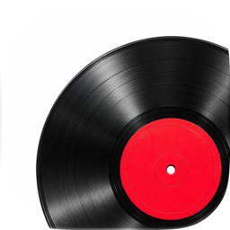
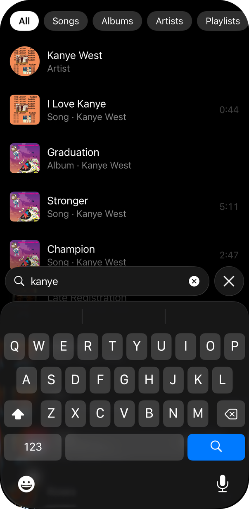
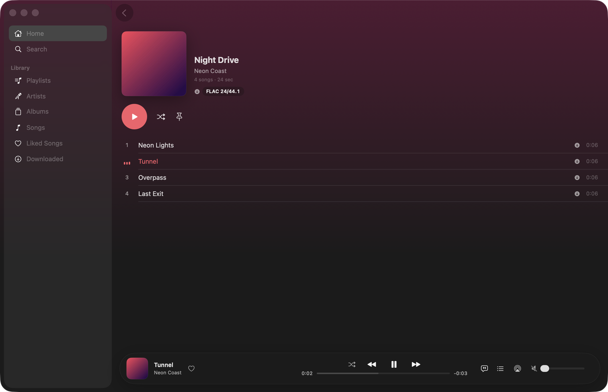

<div align="center">
  
  <h1>Stream</h1>
  
  
  
  
  
  <br><br>
  
</div>

<br>

Stream plays Spotify through [librespot](https://github.com/librespot-org/librespot) and your FLAC, ALAC, AAC, MP3, Ogg Vorbis, Opus, WAV and AIFF files through the same pipeline, so a playlist, an album and a search can mix both. It runs on iOS 27 and macOS 27. Spotify needs Premium and your own Spotify developer app; your own files need nothing.

Because it uses librespot, Stream isn't for the App Store. Install it with `scripts/deploy.sh` or TestFlight.

## Features

- **One library.** Spotify and your own files side by side in Playlists, Artists, Albums, Songs, Uploads and Downloaded, with Made For You, Discover Weekly and the Daily Mixes in Playlists.
- **Home** is a grid of pins above your recents. Long-press any album, song, artist or playlist to pin it.
- **One search** across your library, Spotify and SoundCloud, each song once as its best sounding copy, with type chips and recent searches.
- **SoundCloud** with no developer account: search and play straight away; sign in for your likes and playlists. Songs a label only offers encrypted play from Spotify or your files instead.
- **Your own playlists**, kept with aza on every device, and if you like on Spotify and SoundCloud too: the same songs on each, found by ISRC or by title, artist and length. Changes made there come back.
- **Import a playlist from a link**: paste a Spotify or SoundCloud playlist or album link and it becomes one of your playlists.
- **Services** in Settings: your music, Spotify, SoundCloud and Last.fm, each with its own page; switch any off without signing out. A song on several plays from its best copy.
- **Now Playing** is tinted from the album art and shows the format and quality, like FLAC 24/96 or OGG 320. Behind it, Aurora melts the cover's colours into a mesh that moves with the music; the waveform button beside AirPlay turns it off.
- **Synced lyrics**, word by word where the source has it. Tap a line to seek.
- **A queue** of Play Next and Play Later above the rest of the album or playlist.
- **Artist pages** like Spotify's: header photo, top songs, every release with filter pills, bio, listeners and top cities.
- **Offline.** Download a song, album or playlist from its page or long-press menu. One ⬇ badge marks anything that plays offline.
- **Podcasts** you follow on Spotify, in Library and in search. An episode picks up where you left off and is marked played when you finish it.
- **History** of every song you played, on any device, by day.
- **Pick up where you left off.** The playing song and its position follow you to your other devices.
- **Gapless playback** and one loudness toggle: ReplayGain for files, Spotify's own normalization for Spotify.
- **Last.fm scrobbling** for Spotify and your own files alike.
- Lock Screen, Control Center, AirPlay, and Siri and Shortcuts.

On the Mac there's a floating glass sidebar and player, ⌘K to play or go to anything, songs picked like Finder's (⇧-click, ⌘-click, ⌘A) and copied, cut and pasted between playlists, and a menu bar mini player that keeps the music going after you close the window. Its music folders go up to the Stream node, so the iPhone can stream them or download them for offline.

## Your data

Everything stays on your devices unless you sign in with aza. The library is a SQLite database in the app's container, and your Spotify and Last.fm credentials are in the Keychain, on that device only. Stream reads your music folders in place and never copies or changes them.

Signed in with aza, your settings, pins, history and the list of your own songs sync through aza sync, and the files themselves go to the Stream node at `stream.aza.network`. They are stored by hash, never transcoded, and stream while they play.

Stream talks to Spotify, SoundCloud, [LRCLIB](https://lrclib.net) for lyrics, Last.fm if you sign in, and with aza your aza home node and the Stream node. It asks for no permissions.

## Building

You need Xcode 27, Rust, [uv](https://docs.astral.sh/uv/), XcodeGen and CMake:

```sh
brew install xcodegen cmake
```

Build the Rust core, then open the project:

```sh
scripts/build-core.sh
xcodegen generate && open Stream.xcodeproj
```

To install on this Mac and a connected iPhone, run `scripts/deploy.sh` (`DEVICE=<udid>` picks another iPhone). `scripts/testflight.sh` uploads a build to TestFlight.

To sign in to Spotify, make an app at [developer.spotify.com](https://developer.spotify.com/dashboard) with the redirect URI `http://127.0.0.1:8989/login` and paste its Client ID in Profile. You approve twice in the sign-in sheet: once for your account, through your app, and once for playback.

### Tests

```sh
scripts/test.sh core   # the core, in about a second
scripts/test.sh        # the core, then the UI tests in the Simulator
```

The core tests in `tests/core` drive the same API the apps call: they scan a small fixture library, play it, work the queue and History, and sync pins, History and settings between two devices running in one process. Most tests belong here.

The UI tests are a short smoke run in the Simulator against a fake Spotify, for what only the UI can break. They build their own debug core, launch the app once, and return to Home between tests with `network-aza-stream://reset`. Builds run at low priority, and a second run waits for the first.

These launch arguments are useful while developing:

- `-musicFolder <path>` uses that folder as the local library.
- `-uiTesting YES` isolates the app's data, silences output and saves nothing.
- `-spotifyAccounts <url>` and `-spotifyApi <url>` point it at a fake Spotify.
- `-signInAnswered YES` skips the sign-in screen, and `SAMPLE_ACCOUNT=1` signs in to the sample profile.
- `-url <link>` runs a deep link once the library is scanned, in order: `play?id=…[&track=<title>]`, `open?id=…`, `pin?id=…`, `seek?ms=…`, `nowplaying[?mode=lyrics|queue]`, `search?q=…`. With `-uiTesting`, the app writes `tmp/links-done` when they're all done.

### Screenshots

```sh
python3 -I scripts/demo.py --screenshots
```

This builds a library of real albums with silent audio from `scripts/demo-library.json`, then takes each shot from a fresh launch that deep links straight to the screen, and captures the Mac window. `--cast <name>` picks another set of albums from that file, `--out <dir>` writes the shots somewhere else, and `--only lyrics,album` takes just those.

## How it's built

```
Shared/        SwiftUI for both apps: views, audio output, Now Playing, artwork
iOS/, macOS/   Each app's entry point and platform pieces
core/          The Rust core: Spotify, decoding, queue, library, lyrics, Last.fm, sync
node/          The Stream node: your music files, behind an aza sign-in
Generated/     StreamCore.xcframework and its UniFFI bindings
tests/         Core tests, UI smoke tests, a fake Spotify and a fixture library
scripts/       Build, deploy, test and screenshots
```

Every source decodes in Rust into a ring buffer that an `AVAudioSourceNode` pulls from. The core's UniFFI bindings compile as their own module, `StreamBindings`, without main-actor isolation, so calls into the core stay off the main thread. Sign-in, the profile button and Appearance come from [AzaUI](https://github.com/plarza/ui).

The decisions behind all of this, and what Stream deliberately leaves out, are in [SPEC.md](SPEC.md).
