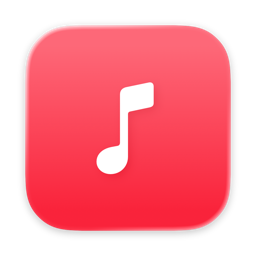
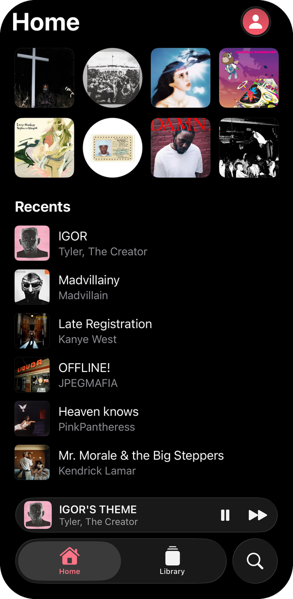
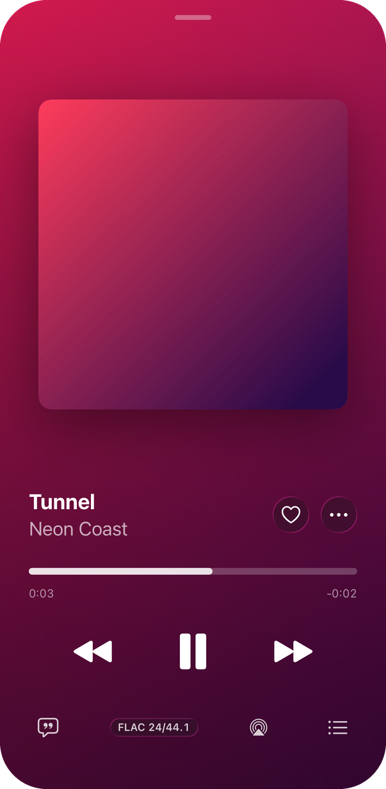
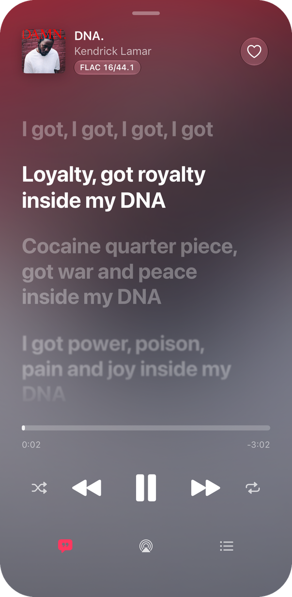
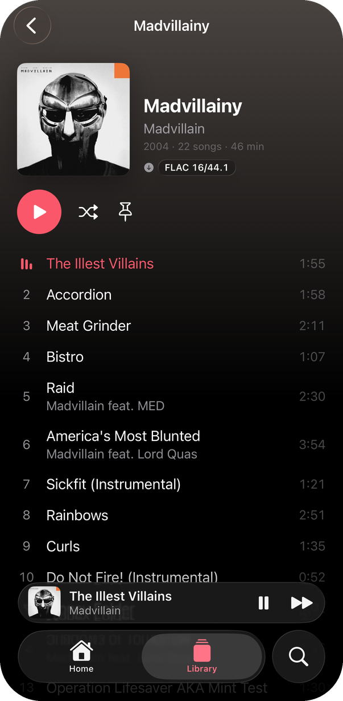

  

<h1 align="center">Stream</h1>

Spotify and your own music files in one player for iPhone and Mac · iOS 26 / macOS 26

  
  
  
  

## Features

- Your Spotify account (Premium) and local files in one library: FLAC, ALAC, AAC, MP3, Ogg, Opus, WAV, AIFF
- Liquid Glass design, with Now Playing tinted from the album art
- Synced lyrics, word by word where the source has it (Spotify, the file's own tags, LRCLIB)
- Gapless playback and loudness normalization
- Pins and recents on Home; one search across your library and Spotify
- Last.fm scrobbling for local files
- iPhone mirrors the Mac's music folders over Wi-Fi
- Mac: floating glass player, menu bar mini player, ⌘K to play or go to anything

## How it works

A Rust core does the work: Spotify through [librespot](https://github.com/librespot-org/librespot), decoding with Symphonia and libopus, the library in SQLite, lyrics, scrobbling and Wi-Fi sync. SwiftUI apps for iPhone and Mac sit on top through UniFFI. Audio goes from the core's ring buffer straight into an `AVAudioSourceNode`, so every source shares one gapless pipeline. Decisions and scope are in [SPEC.md](SPEC.md).

## Develop

Needs Xcode 26, Rust and `brew install xcodegen cmake`.

| Task | Command |
|---|---|
| Build the Rust core | `scripts/build-core.sh` |
| Open in Xcode | `xcodegen generate && open Stream.xcodeproj` |
| Install on this Mac and the iPhone | `scripts/deploy.sh` |
| Upload to TestFlight | `scripts/testflight.sh` |
| UI tests in the Simulator | `scripts/test.sh` |
| Refresh these screenshots | `python3 -I scripts/demo.py --screenshots` |

Spotify sign-in needs your own app at [developer.spotify.com](https://developer.spotify.com/dashboard) with redirect URI `http://127.0.0.1:8989/login`; paste its Client ID in Settings.
